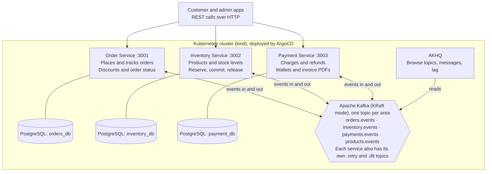
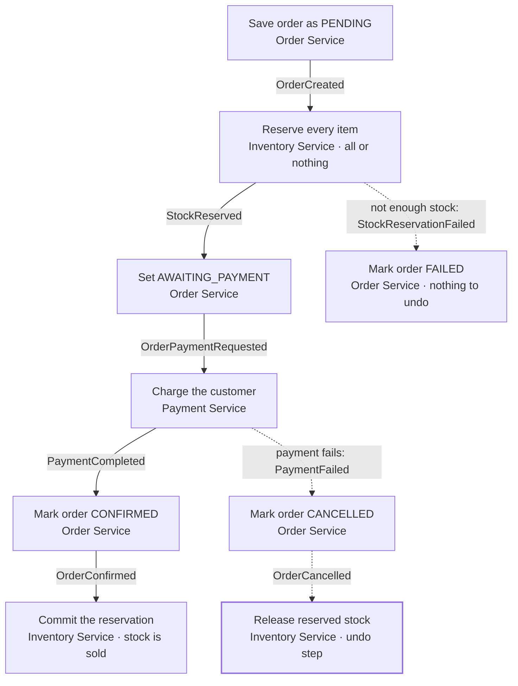

# ShopFlow: E-Commerce Event-Driven Backend Plan

Nov 22, 2026 · T N Shambulinga

## 1. Overview

ShopFlow is an e-commerce backend made of 3 NestJS microservices (Order, Inventory, Payment) that talk to each other only through Apache Kafka. When a customer places an order, the services reserve stock, take payment, and then confirm or undo the order using events, with no direct API calls between services. Plan for about 6 weeks of part-time work.

### What you will be able to show at the end

- A customer places an order through a REST API, and the order moves by itself from PENDING to AWAITING_PAYMENT to CONFIRMED.
- If payment fails, the system undoes the earlier steps on its own: the reserved stock goes back and the order is cancelled. This is the **Saga pattern**.
- Two customers buying the last item at the same moment never both get it. There is **no overselling**.
- A service can go down for a few minutes and no order is lost. It catches up from Kafka when it comes back.
- Everything runs on Kubernetes, deployed by **ArgoCD**, with every Kafka message visible in **AKHQ**.

### Tech stack (Kafka only, no RabbitMQ)

| Area           | Tool                                                                                    | Why this tool                                            |
| -------------- | --------------------------------------------------------------------------------------- | -------------------------------------------------------- |
| Language       | TypeScript 5 on Node.js 20 LTS                                                          | Type safety across services and shared event types       |
| Framework      | NestJS 10                                                                               | Modules, dependency injection, built-in Kafka transport  |
| Database       | PostgreSQL 16, one database per service                                                 | Each service owns its own data                           |
| ORM            | TypeORM with migrations                                                                 | Entities, repositories, transactions, `@VersionColumn` |
| Messaging      | Apache Kafka in KRaft mode (no ZooKeeper) via `@nestjs/microservices` and `kafkajs` | Durable events, replay, ordering per key                 |
| Validation     | `class-validator` + `class-transformer`                                             | DTO validation with decorators                           |
| API docs       | `@nestjs/swagger`                                                                     | Auto-generated API docs at `/docs`                     |
| Logging        | `nestjs-pino`                                                                         | JSON logs that carry a correlation ID                    |
| Health checks  | `@nestjs/terminus`                                                                    | Liveness and readiness probes for Kubernetes             |
| Multithreading | `worker_threads` through `piscina`                                                  | Heavy CPU work off the main event loop                   |
| Testing        | Jest, Supertest, Testcontainers                                                         | Unit tests, API tests, real Postgres and Kafka in tests  |
| Deploy         | Docker, kind, Helm, Strimzi, GitHub Actions, ArgoCD                                     | Local Kubernetes with GitOps deploys                     |
| Kafka UI       | AKHQ                                                                                    | Browse topics, messages, consumer lag, dead letters      |

Since there is no RabbitMQ, retries and dead-letter handling are built with extra Kafka topics instead (section 4).

## 2. Architecture

The three services never call each other and never share a database. Customers and admins use each service's REST APIs; every piece of work between services travels as an event through Kafka.



Each service reads and writes only its own database, and sends and receives events through Kafka topics.

- **Database per service:** the Order Service cannot read the `stock` table. If it needs product data, it keeps its own copy, filled by `ProductUpdated` events. This keeps services independent, so one can change its tables without breaking the others.
- **REST for people, Kafka for services:** REST is used only by the client (customer or admin). Service-to-service work is always an event.
- **Choreography, not a central boss:** no service tells the others what to do. Each one listens for events it cares about, does its own job, and announces the result. Section 5 shows the full flow.
- **What you gain:** if the Payment Service is down for 10 minutes, orders simply wait in Kafka and finish when it comes back. Nothing is lost and no other service breaks.

## 3. The three services in detail

Each service has its own REST APIs for its own data, its own database, and a short list of events it publishes and listens to. Business work between services happens only through events.

### 3.1 Order Service (port 3001, database `orders_db`)

**Job:** Takes orders from customers, calculates the total with discounts, and tracks the order status from start to finish. It is the service the customer talks to.

**REST APIs**

| Method and path                                         | What it does                                                                                       | Main responses                                            |
| ------------------------------------------------------- | -------------------------------------------------------------------------------------------------- | --------------------------------------------------------- |
| `POST /api/v1/orders`                                 | Place an order. Takes an `Idempotency-Key` header so a retried request never creates two orders. | 201 created, 400 bad input, 422 invalid coupon            |
| `GET /api/v1/orders/:id`                              | Get one order with its items and status                                                            | 200, 404                                                  |
| `GET /api/v1/orders?customerId=&status=&page=&limit=` | List orders with filters and pagination                                                            | 200                                                       |
| `POST /api/v1/orders/:id/cancel`                      | Customer cancels an order                                                                          | 202 accepted, 409 if the order can no longer be cancelled |
| `POST /api/v1/coupons`                                | Admin creates a coupon                                                                             | 201, 409 duplicate code                                   |

**Database tables**

| Table                                   | Important columns                                                                                                                                                                                                                                |
| --------------------------------------- | ------------------------------------------------------------------------------------------------------------------------------------------------------------------------------------------------------------------------------------------------ |
| `orders`                              | `id` (uuid), `customer_id`, `status`, `subtotal`, `discount_amount`, `total_amount`, `currency`, `payment_method`, `coupon_code`, `cancel_reason`, `idempotency_key` (unique), `version`, `created_at`, `updated_at` |
| `order_items`                         | `id`, `order_id`, `product_id`, `sku`, `product_name`, `quantity`, `unit_price`                                                                                                                                                    |
| `order_status_history`                | `order_id`, `from_status`, `to_status`, `reason`, `changed_at` (a full audit trail)                                                                                                                                                    |
| `coupons`                             | `code` (unique), `type` (PERCENTAGE, FLAT, BOGO), `percent_off` (PERCENTAGE only), `amount_off` (FLAT only), `min_order_amount`, `expires_at`, `active`                                                                                                                                |
| `product_catalog`                     | A **local read-only copy** of products (`product_id`, `sku`, `name`, `price`, `active`) kept up to date from `ProductUpdated` events                                                                                           |
| `outbox_events`, `processed_events` | Reliability tables, explained in section 7                                                                                                                                                                                                       |

Why keep a local copy of products? So the Order Service can check prices and product names without calling the Inventory Service. If Inventory is down, customers can still place orders.

**Order statuses**

| Status           | Meaning                                             | Can move to                                    |
| ---------------- | --------------------------------------------------- | ---------------------------------------------- |
| PENDING          | Order saved, waiting for stock check                | AWAITING_PAYMENT, FAILED, CANCELLED            |
| AWAITING_PAYMENT | Stock reserved, payment requested                   | CONFIRMED, CANCELLED                           |
| CONFIRMED        | Paid, stock taken for good                          | CANCELLED (customer cancel, triggers a refund) |
| FAILED           | Out of stock, nothing to undo                       | none (final)                                   |
| CANCELLED        | Cancelled by the customer or because payment failed | REFUNDED (only if it had been paid)            |
| REFUNDED         | Money returned to the customer                      | none (final)                                   |

Any other move throws `InvalidOrderStateException` (HTTP 409). Keep these rules in one small `OrderStateMachine` class so they are easy to test.

**Kafka:** publishes `OrderCreated`, `OrderPaymentRequested`, `OrderConfirmed`, `OrderCancelled`. Listens to `StockReserved`, `StockReservationFailed`, `PaymentCompleted`, `PaymentFailed`, `PaymentRefunded`, `ProductUpdated`.

### 3.2 Inventory Service (port 3002, database `inventory_db`)

**Job:** Owns the product catalog and stock levels. It reserves stock for new orders, releases it when an order is cancelled, and commits it when an order is paid.

**REST APIs**

| Method and path                               | What it does                                                        | Main responses            |
| --------------------------------------------- | ------------------------------------------------------------------- | ------------------------- |
| `POST /api/v1/products`                     | Add a product with a starting stock                                 | 201, 409 duplicate SKU    |
| `GET /api/v1/products?search=&page=&limit=` | List and search products                                            | 200                       |
| `GET /api/v1/products/:id`                  | Get one product with available and reserved stock                   | 200, 404                  |
| `PATCH /api/v1/products/:id`                | Change name, price or active flag (publishes `ProductUpdated`)    | 200, 404                  |
| `POST /api/v1/products/:id/restock`         | Add more stock                                                      | 200, 404                  |
| `POST /api/v1/products/bulk-import`         | Upload a CSV of products, processed with worker threads (section 8) | 202 with an import job ID |
| `GET /api/v1/imports/:jobId`                | Check bulk import progress and row errors                           | 200, 404                  |

**Database tables**

| Table                                   | Important columns                                                                                              |
| --------------------------------------- | -------------------------------------------------------------------------------------------------------------- |
| `products`                            | `id`, `sku` (unique), `name`, `price`, `active`, `created_at`, `updated_at`                      |
| `stock`                               | `product_id`, `available_qty`, `reserved_qty`, `version`                                               |
| `stock_reservations`                  | `id`, `order_id`, `product_id`, `quantity`, `status` (RESERVED, COMMITTED, RELEASED), `created_at` |
| `import_jobs`                         | `id`, `status`, `total_rows`, `success_rows`, `failed_rows`, `errors` (json)                       |
| `outbox_events`, `processed_events` | Reliability tables (section 7)                                                                                 |

**Key rule:** stock for an order is reserved **all or nothing**. If an order has 3 items and only 2 are in stock, nothing is reserved and `StockReservationFailed` is published with the missing items.

**Kafka:** publishes `StockReserved`, `StockReservationFailed`, `StockReleased`, `ProductUpdated`. Listens to `OrderCreated` (reserve), `OrderConfirmed` (commit), `OrderCancelled` (release).

### 3.3 Payment Service (port 3003, database `payment_db`)

**Job:** Charges the customer when asked, refunds when an order is cancelled after payment, and creates an invoice PDF for each successful payment.

There is no real payment gateway. Each payment method is a **fake gateway class** with clear rules for success and failure, so you can test the Saga on purpose.

| Payment method | Fake rule                                                                                                             |
| -------------- | --------------------------------------------------------------------------------------------------------------------- |
| WALLET         | Fails if the customer's wallet balance is lower than the amount                                                       |
| CARD           | Fails if the amount is above a set limit (for example ₹1,00,000)                                                     |
| UPI            | Fails at a set random rate from config (for example 10%), using an injectable random source so tests stay predictable |

**REST APIs**

| Method and path                             | What it does                  | Main responses                |
| ------------------------------------------- | ----------------------------- | ----------------------------- |
| `GET /api/v1/payments/:id`                | Get one payment               | 200, 404                      |
| `GET /api/v1/payments?orderId=`           | Find the payment for an order | 200                           |
| `GET /api/v1/payments/:id/invoice`        | Download the invoice PDF      | 200, 404 if not generated yet |
| `POST /api/v1/wallets/:customerId/top-up` | Add money to a test wallet    | 200, 400                      |
| `GET /api/v1/wallets/:customerId`         | See the wallet balance        | 200, 404                      |

**Database tables**

| Table                                   | Important columns                                                                                                                                                                                                                    |
| --------------------------------------- | ------------------------------------------------------------------------------------------------------------------------------------------------------------------------------------------------------------------------------------ |
| `payments`                            | `id`, `order_id` (unique, so one order is never charged twice), `customer_id`, `amount`, `currency`, `method`, `status` (COMPLETED, FAILED, REFUNDED, CANCELLED), `failure_reason`, `invoice_path`, `created_at` |
| `wallets`                             | `customer_id`, `balance`, `version`                                                                                                                                                                                            |
| `outbox_events`, `processed_events` | Reliability tables (section 7)                                                                                                                                                                                                       |

**Kafka:** publishes `PaymentCompleted`, `PaymentFailed`, `PaymentRefunded`. Listens to `OrderPaymentRequested` (charge) and `OrderCancelled` (refund if it was paid).

## 4. Kafka design

Use **one topic per business area** (orders, inventory, payments, products), and use the **order ID as the message key**. Kafka keeps messages with the same key in the same partition, so every event for one order is read in the exact order it was written.

### 4.1 Topics

| Topic                                                                           | Written by                                | Read by                         | Message key   | Partitions (local / prod) |
| ------------------------------------------------------------------------------- | ----------------------------------------- | ------------------------------- | ------------- | ------------------------- |
| `orders.events`                                                               | Order Service                             | Inventory, Payment              | `orderId`   | 3 / 6                     |
| `inventory.events`                                                            | Inventory Service                         | Order                           | `orderId`   | 3 / 6                     |
| `payments.events`                                                             | Payment Service                           | Order                           | `orderId`   | 3 / 6                     |
| `products.events`                                                             | Inventory Service                         | Order                           | `productId` | 3 / 6                     |
| `order-service.retry`, `inventory-service.retry`, `payment-service.retry` | Each service, for its own failed messages | The same service, after a delay | original key  | 3 / 3                     |
| `order-service.dlt`, `inventory-service.dlt`, `payment-service.dlt`       | Each service, after all retries fail      | You, in AKHQ                    | original key  | 1 / 3                     |

Rules for topics:

- Create topics with a script (a `kafka-init` container locally, Strimzi `KafkaTopic` files in Kubernetes). Turn off auto-create so a typo never makes a new topic.
- Replication factor 1 locally, 3 in a real cluster.
- Keep `products.events` with **log compaction** turned on. Kafka then keeps only the latest message per product, so a new Order Service can rebuild its product copy by reading the whole topic.

### 4.2 Why one topic per area and not one topic per event?

If `OrderConfirmed` and `OrderCancelled` were in different topics, the Inventory Service could read the cancel before the confirm and get confused. With one `orders.events` topic keyed by `orderId`, both land in the same partition in the right order. Inside the service, a small **event dispatcher** looks at `eventType` and sends the message to the right handler class (this is the Strategy pattern again, see section 6).

### 4.3 Consumer groups and scaling

- Each service has one consumer group: `order-service`, `inventory-service`, `payment-service`.
- Kafka splits a topic's partitions between the running copies of a service. With 6 partitions you can run up to 6 copies of a service, and each copy handles a share of the orders.
- Run 2 copies of each service in Kubernetes. Then kill one and watch in AKHQ as its partitions move to the other copy. This is a great demo.

### 4.4 Producer and consumer settings

| Setting                    | Value                                             | Why                                                                       |
| -------------------------- | ------------------------------------------------- | ------------------------------------------------------------------------- |
| Producer `idempotent`    | `true`                                          | Kafka itself drops duplicate sends caused by network retries              |
| Producer `acks`          | `all` (-1)                                      | A message counts as sent only when all replicas have it                   |
| Consumer offset commit     | Manual, **after** the database work commits | If the service crashes mid-way, the message is read again, never lost     |
| Delivery guarantee         | At-least-once                                     | Duplicates are possible, so every consumer must be idempotent (section 7) |
| `allowAutoTopicCreation` | `false`                                         | No accidental topics                                                      |

### 4.5 The event envelope (the shape of every message)

Every event uses the same outer shape. Only `payload` changes between event types.

```json
{
  "eventId": "5f0c8a2e-1b7d-4c3a-9e21-0d4f6a7b8c90",
  "eventType": "OrderCreated",
  "eventVersion": 1,
  "occurredAt": "2026-11-22T10:15:00.000Z",
  "aggregateId": "ord_7d1e...",
  "correlationId": "c-91ab...",
  "causationId": null,
  "producer": "order-service",
  "payload": {
    "orderId": "ord_7d1e...",
    "customerId": "cus_42...",
    "items": [{ "productId": "prd_1...", "quantity": 2, "unitPrice": 499.0 }],
    "totalAmount": 898.2,
    "currency": "INR",
    "paymentMethod": "WALLET"
  }
}
```

- `eventId`: unique ID, used to skip duplicates.
- `correlationId`: the same value for every event of one order journey, so you can follow one order across all 3 services in the logs.
- `causationId`: the `eventId` of the event that caused this one. It shows the chain: OrderCreated caused StockReserved, which caused OrderPaymentRequested.
- `eventVersion`: lets you change an event's shape later without breaking older consumers. Only add new fields; never rename or remove fields in the same version.

Put all event types and payload classes in a shared library (`libs/contracts`) so every service uses the same definitions.

### 4.6 Event catalog

| Event                      | Topic                | Producer  | Consumers          | Main payload fields                                         |
| -------------------------- | -------------------- | --------- | ------------------ | ----------------------------------------------------------- |
| `OrderCreated`           | `orders.events`    | Order     | Inventory          | orderId, customerId, items, totalAmount, paymentMethod      |
| `OrderPaymentRequested`  | `orders.events`    | Order     | Payment            | orderId, customerId, amount, currency, paymentMethod        |
| `OrderConfirmed`         | `orders.events`    | Order     | Inventory          | orderId                                                     |
| `OrderCancelled`         | `orders.events`    | Order     | Inventory, Payment | orderId, reason (CUSTOMER_REQUEST or PAYMENT_FAILED)        |
| `StockReserved`          | `inventory.events` | Inventory | Order              | orderId, reservationIds                                     |
| `StockReservationFailed` | `inventory.events` | Inventory | Order              | orderId, unavailableItems (productId, requested, available) |
| `StockReleased`          | `inventory.events` | Inventory | Order (audit only) | orderId, items                                              |
| `PaymentCompleted`       | `payments.events`  | Payment   | Order              | orderId, paymentId, amount                                  |
| `PaymentFailed`          | `payments.events`  | Payment   | Order              | orderId, reason                                             |
| `PaymentRefunded`        | `payments.events`  | Payment   | Order              | orderId, paymentId, amount                                  |
| `ProductUpdated`         | `products.events`  | Inventory | Order              | productId, sku, name, price, active                         |

### 4.7 Retries and dead letters, using only Kafka

When a handler fails, the error type decides what happens:

1. **Temporary error** (database timeout, a lock conflict): the consumer copies the message to its `<service>.retry` topic with headers `x-attempt`, `x-original-topic` and `x-error`. A retry consumer waits before trying again (1 s, then 5 s, then 30 s).
2. **After 3 failed attempts**, the message goes to `<service>.dlt` (dead-letter topic).
3. **Permanent error** (bad message shape, unknown event type): it goes straight to the DLT. Retrying will never fix it.
4. You look at DLT messages in AKHQ, fix the bug, and replay them with a small admin script that moves them back to the original topic.

This gives you the same safety that RabbitMQ dead-letter queues give, with Kafka only.

## 5. Event flows and the Saga pattern

ShopFlow uses a **choreography Saga**: each service reacts to events, does its own step, and announces the result, and every step that changes data has an undo step. If payment fails, the reserved stock is released automatically, without any service calling another.

A **Saga** is a way to run one business process across several services when you cannot use one database transaction. Instead of "all or nothing" in one go, each step commits on its own, and if a later step fails, earlier steps are undone with **compensating actions** (for example, "release stock" undoes "reserve stock").



Read it top to bottom: the main column is the happy path, and the dashed arrows are the two ways an order can fail.

### 5.1 Every scenario, event by event

| Scenario                       | Events, in order                                                                                 | Final result                                                                    |
| ------------------------------ | ------------------------------------------------------------------------------------------------ | ------------------------------------------------------------------------------- |
| Happy path                     | OrderCreated, StockReserved, OrderPaymentRequested, PaymentCompleted, OrderConfirmed             | Order CONFIRMED, stock committed (sold), payment COMPLETED, invoice PDF created |
| Out of stock                   | OrderCreated, StockReservationFailed                                                             | Order FAILED, stock unchanged, no payment row                                   |
| Payment fails                  | OrderCreated, StockReserved, OrderPaymentRequested, PaymentFailed, OrderCancelled, StockReleased | Order CANCELLED (reason PAYMENT_FAILED), stock back to where it was             |
| Customer cancels after paying  | OrderCancelled, then StockReleased and PaymentRefunded                                           | Order REFUNDED, stock back, wallet refunded                                     |
| Customer cancels before paying | OrderCancelled, then StockReleased                                                               | Order CANCELLED, stock back, no charge                                          |

### 5.2 Who reacts to what

1. **Order Service** saves the order as PENDING and writes `OrderCreated` to the outbox in the same transaction.
2. **Inventory Service** reads `OrderCreated` and tries to reserve every item. It publishes `StockReserved` if all items fit, or `StockReservationFailed` with the missing items.
3. **Order Service** reads the result. On success it sets AWAITING_PAYMENT and publishes `OrderPaymentRequested` with the amount. On failure it sets FAILED and stops (nothing was reserved, so nothing to undo).
4. **Payment Service** reads `OrderPaymentRequested`, picks the gateway strategy, and publishes `PaymentCompleted` or `PaymentFailed`.
5. **Order Service** reads the payment result. On success it sets CONFIRMED and publishes `OrderConfirmed`. On failure it sets CANCELLED and publishes `OrderCancelled`.
6. **Inventory Service** commits the reservation on `OrderConfirmed`, or releases it on `OrderCancelled`.
7. **Payment Service** also reads `OrderCancelled`. If it holds a completed payment for that order, it refunds it and publishes `PaymentRefunded`.

### 5.3 Tricky timing cases (great interview material)

| Case                                                        | What happens                                                                                                                                                                                                    | Why it is safe                                                                                                                                                   |
| ----------------------------------------------------------- | --------------------------------------------------------------------------------------------------------------------------------------------------------------------------------------------------------------- | ---------------------------------------------------------------------------------------------------------------------------------------------------------------- |
| Customer cancels while the payment is still being processed | Payment charges first, then reads `OrderCancelled` and refunds. Order ignores the late `PaymentCompleted` (the state machine blocks it, so log it and move on) and becomes REFUNDED on `PaymentRefunded`. | Both events are in `orders.events` with the same key, so Payment always sees them in order. Payment refunds based on what it holds, not on what Order thought. |
| Customer cancels while stock is still being reserved        | Inventory reserves, then releases right after.                                                                                                                                                                  | Same partition, so `OrderCreated` is always handled before `OrderCancelled`.                                                                                 |
| A retry breaks the order                                    | If `OrderPaymentRequested` went to the retry topic, `OrderCancelled` may be handled first. Payment then saves a CANCELLED marker row for that order, and the late payment request is skipped.               | Retry topics do not keep order, so each service remembers cancelled order IDs and refuses later work for them.                                                   |
| The same event arrives twice                                | The second copy is skipped.                                                                                                                                                                                     | `processed_events` check (section 7.2).                                                                                                                        |
| A service is down                                           | Its events wait in Kafka; it continues from its last committed offset when it restarts.                                                                                                                         | Kafka stores events; offsets are committed only after the database work succeeds.                                                                                |

### 5.4 Choreography vs orchestration

|              | Choreography (used here)                                        | Orchestration                                                      |
| ------------ | --------------------------------------------------------------- | ------------------------------------------------------------------ |
| How it works | Each service listens and reacts to events                       | One coordinator service sends commands and tracks the Saga's state |
| Good for     | Short flows with few steps, like this one                       | Long flows with many steps and branches                            |
| Downside     | The full flow is spread across services, so it is harder to see | The coordinator is extra code and a central point to maintain      |

In interviews, say you chose choreography because the flow has only 3 services and a few steps, and that you would switch to orchestration if the flow grew (for example, adding shipping, loyalty points and fraud checks).

## 6. Code structure and design patterns

Build everything in one NestJS monorepo with 3 apps and 3 shared libraries. Every service follows the same layers, so once you know one service you know all of them.

### 6.1 Monorepo layout

```text
shopflow/
├── apps/
│   ├── order-service/
│   │   ├── src/
│   │   │   ├── main.ts
│   │   │   ├── app.module.ts
│   │   │   ├── config/                         # database.config.ts, data-source.ts (migration CLI)
│   │   │   ├── controllers/                    # orders.controller.ts, coupons.controller.ts: HTTP only
│   │   │   ├── services/                       # orders.service.ts, catalog.service.ts: business rules
│   │   │   ├── repository/                     # order.repository.ts: interface + TypeORM class
│   │   │   ├── entities/                       # order.entity.ts, order-item.entity.ts, product-catalog.entity.ts
│   │   │   ├── dto/                            # create-order.dto.ts, order-response.dto.ts, list-orders.query.ts
│   │   │   ├── mappers/                        # order.mapper.ts: entity <-> DTO
│   │   │   ├── domain/                         # order-state-machine.ts, discount strategies (Strategy pattern)
│   │   │   ├── exceptions/                     # invalid-order-state.exception.ts ...
│   │   │   ├── messaging/handlers/             # one class per incoming event
│   │   │   ├── modules/                        # database.module.ts, orders.module.ts ...
│   │   │   └── migrations/
│   │   └── test/                               # mirrors src/: unit (*.spec.ts) and integration (*.int-spec.ts)
│   ├── inventory-service/                      # same layout
│   └── payment-service/                        # same layout
├── libs/
│   ├── common/      # exception filter, correlation ID, logger, pagination DTO, base exceptions
│   ├── messaging/   # Kafka publisher, outbox, idempotent consumer, retry/DLT, event dispatcher
│   └── contracts/   # topic names, event types, payload classes (shared by all services)
├── deploy/
│   ├── helm/
│   └── argocd/
├── docker-compose.yml
└── .github/workflows/
```

Create it with `nest new shopflow`, then `nest generate app inventory-service` and `nest generate library messaging`. Nest CLI handles monorepo builds for you.

### 6.2 The layers

| Layer         | What it does                                                                         | What it must NOT do              |
| ------------- | ------------------------------------------------------------------------------------ | -------------------------------- |
| Controller    | Reads the HTTP request, validates the DTO, calls the service, returns a response DTO | Business rules, database queries |
| Event handler | The "controller" for Kafka: reads one event type and calls the service               | Business rules, database queries |
| Service       | All business rules, transactions, writing outbox events                              | Know about HTTP or Kafka details |
| Repository    | Reads and writes the database                                                        | Business decisions               |
| Mapper        | Converts entities to DTOs and back                                                   | Anything else                    |

Because both controllers and event handlers call the **same service methods**, the business logic is written once and tested once.

### 6.3 DTOs and validation

Every request body, query string and response has its own DTO class. You never send a TypeORM entity out of an API.

```ts
export class CreateOrderItemDto {
  @IsUUID() productId: string;
  @IsInt() @Min(1) @Max(10) quantity: number;
}

export class CreateOrderDto {
  @IsUUID() customerId: string;

  @IsArray() @ArrayMinSize(1) @ArrayMaxSize(50)
  @ValidateNested({ each: true }) @Type(() => CreateOrderItemDto)
  items: CreateOrderItemDto[];

  @IsEnum(PaymentMethod) paymentMethod: PaymentMethod;

  @IsOptional() @IsString() @Length(3, 20) couponCode?: string;
}
```

Turn validation on for the whole app in `main.ts`:

```ts
app.useGlobalPipes(new ValidationPipe({
  whitelist: true,              // drop unknown fields
  forbidNonWhitelisted: true,   // or reject them with 400
  transform: true,              // turn plain JSON into DTO class instances
}));
```

Validate **incoming Kafka events** too. Use the same `class-validator` classes from `libs/contracts`. A bad event goes straight to the dead-letter topic.

### 6.4 Global exception handling

One `AllExceptionsFilter` in `libs/common` turns every error into the same JSON shape:

```json
{
  "statusCode": 409,
  "code": "INVALID_ORDER_STATE",
  "error": "Conflict",
  "message": "Order cannot move to the requested status",
  "details": { "orderId": "ord_7d1e", "from": "FAILED", "to": "CANCELLED" },
  "path": "/api/v1/orders/ord_7d1e/cancel",
  "timestamp": "2026-11-22T10:20:00.000Z",
  "correlationId": "c-91ab..."
}
```

| Exception                                                                              | HTTP status | When                                                       |
| -------------------------------------------------------------------------------------- | ----------- | ---------------------------------------------------------- |
| `OrderNotFoundException`, `ProductNotFoundException`, `PaymentNotFoundException` | 404         | ID does not exist                                          |
| `InvalidOrderStateException`                                                         | 409         | A status move the state machine does not allow             |
| `DuplicateSkuException`, `DuplicateCouponException`                                | 409         | Unique value already used                                  |
| `InvalidCouponException`                                                             | 422         | Coupon expired, inactive, or minimum amount not met        |
| Validation errors from `ValidationPipe`                                              | 400         | Bad request body or query                                  |
| TypeORM `QueryFailedError` with Postgres code `23505`                              | 409         | A unique constraint the code did not catch                 |
| Anything else                                                                          | 500         | Logged with stack trace; the client sees a generic message |

Every error code is defined once, in the service's `src/constants/errors.ts` catalog, with its kind (`not_found`, `conflict`, `unprocessable`, `invalid_input`) and message. All custom exceptions extend one `DomainException` base class and take an entry from that catalog, plus `details` for the specific IDs. The filter maps the kind to an HTTP status and also sends the code in an `X-Error-Code` header.

### 6.5 Repository pattern

The service depends on an **interface**, not on TypeORM:

```ts
export interface OrderRepository {
  findById(id: string): Promise<Order | null>;
  findByIdempotencyKey(key: string): Promise<Order | null>;
  save(order: Order, manager?: EntityManager): Promise<Order>;
  list(filter: OrderFilter, page: PageRequest): Promise<Page<Order>>;
}
export const ORDER_REPOSITORY = Symbol('ORDER_REPOSITORY');

// in the module
{ provide: ORDER_REPOSITORY, useClass: TypeOrmOrderRepository }
```

In unit tests you swap in a mock or a simple in-memory version. The service code does not change.

### 6.6 Strategy pattern (4 places)

| Where                         | Interface                                                   | Strategies                                                                 | Picked by                                         |
| ----------------------------- | ----------------------------------------------------------- | -------------------------------------------------------------------------- | ------------------------------------------------- |
| Order: discounts              | `DiscountStrategy.apply(subtotal, items, coupon)`         | `NoDiscount`, `PercentageDiscount`, `FlatDiscount`, `BuyOneGetOne` | `DiscountStrategyFactory` using the coupon type |
| Payment: methods              | `PaymentGateway.charge(request)` and `.refund(payment)` | `WalletGateway`, `CardGateway`, `UpiGateway`                         | `PaymentGatewayFactory` using `paymentMethod` |
| All services: incoming events | `EventHandler.handle(envelope)`                           | One class per event, for example `StockReservedHandler`                  | `EventDispatcher` using `eventType`           |
| Messaging: retry delay        | `BackoffStrategy.nextDelay(attempt)`                      | `FixedBackoff`, `ExponentialBackoff`                                   | Config value                                      |

Adding a new coupon type or payment method means adding one new class and registering it. You never edit the existing classes.

### 6.7 SOLID in this project

| Principle                       | Simple meaning                                     | Where you can show it                                                                                         |
| ------------------------------- | -------------------------------------------------- | ------------------------------------------------------------------------------------------------------------- |
| **S**ingle responsibility | One class, one job                                 | Controller only does HTTP; `OrderStateMachine` only checks status moves; `OutboxRelay` only publishes     |
| **O**pen/closed           | Add features by adding code, not changing old code | New discount or payment method = new strategy class                                                           |
| **L**iskov substitution   | Any implementation can replace another             | Every `PaymentGateway` returns the same result type and follows the same rules                              |
| **I**nterface segregation | Small, focused interfaces                          | `EventPublisher` and `EventHandler` are separate; read and write repository methods can be split          |
| **D**ependency inversion  | Depend on interfaces, not concrete classes         | Services inject `ORDER_REPOSITORY`, `PaymentGateway` and a `RandomSource` token, never the real classes |

## 7. Production reliability

Four features make ShopFlow safe when things go wrong: the transactional outbox, idempotent consumers, safe stock updates, and correlation IDs. These are the parts that separate this project from a tutorial project, so build them properly and be ready to explain them.

### 7.1 Transactional outbox (never lose an event)

**The problem (called the dual-write problem):** the service must save the order in Postgres **and** send an event to Kafka. These are two different systems. If the app crashes after saving the order but before sending the event, the order is stuck in PENDING forever.

**The fix:** do not send to Kafka directly. In the **same database transaction** as the business change, insert a row into an `outbox_events` table. A separate background job (the outbox relay) reads unsent rows and publishes them.

```ts
await this.dataSource.transaction(async (manager) => {
  const order = await this.orderRepo.save(newOrder, manager);
  await this.outbox.add(manager, {
    topic: Topics.ORDERS,
    key: order.id,
    eventType: 'OrderCreated',
    payload: toOrderCreatedPayload(order),
  });
}); // both rows are saved, or neither is
```

**`outbox_events` table:** `id`, `topic`, `message_key`, `event_type`, `payload` (jsonb), `headers` (jsonb), `created_at`, `published_at` (null until sent), `attempts`.

**The relay** (in `libs/messaging`) runs every 500 ms:

1. Picks up to 100 unsent rows with `SELECT ... WHERE published_at IS NULL ORDER BY created_at FOR UPDATE SKIP LOCKED`. `SKIP LOCKED` lets 2 copies of a service run the relay without sending the same row twice.
2. Publishes them to Kafka in one batch.
3. Sets `published_at` on success.
4. A daily job deletes rows published more than 7 days ago.

The relay might send a row twice if it crashes between steps 2 and 3. That is fine, because consumers skip duplicates (7.2).

### 7.2 Idempotent consumers (handle duplicates safely)

Kafka gives **at-least-once** delivery, so the same event can arrive twice. Every consumer must give the same result whether it sees an event once or five times.

**`processed_events` table:** `event_id` and `consumer_name` together as the primary key, plus `processed_at`.

Inside the handler's transaction:

1. Insert `(eventId, consumerName)` into `processed_events`.
2. If the insert fails with a unique violation, the event was already handled. Commit nothing new and acknowledge the message.
3. Otherwise, do the business change (and any outbox insert) in the same transaction.

Wrap this in one reusable helper, for example `idempotent(manager, envelope, () => ...)`, so handlers stay short.

Also keep business-level guards. For example, `payments.order_id` is unique, so even a bug can never charge the same order twice.

### 7.3 No overselling (safe stock updates)

Imagine 10 units are left and 20 customers order at the same moment. A naive "read stock, check, then save" lets many of them pass the check before anyone saves.

**The fix:** check and update in **one SQL statement**:

```sql
UPDATE stock
SET available_qty = available_qty - $1,
    reserved_qty  = reserved_qty  + $1
WHERE product_id = $2
  AND available_qty >= $1;
```

If the statement changes 0 rows, there was not enough stock. Postgres runs this safely even when many requests come in at once. Do this for every item of the order inside one transaction. If any item returns 0 rows, roll back the whole transaction and publish `StockReservationFailed`.

**Optimistic locking for other rows:** add `@VersionColumn()` to `orders` and `wallets`. TypeORM then adds `WHERE version = :old` to every update. If two updates clash, one fails with `OptimisticLockVersionMismatchError`, and that message goes to the retry topic.

Be ready to explain both: the single conditional `UPDATE` is best for counters like stock; version columns are best for whole rows like an order.

### 7.4 Correlation IDs and logging

- An HTTP middleware reads the `X-Correlation-Id` header, or creates a new one if missing.
- Store it per request with `AsyncLocalStorage` (the `nestjs-cls` package makes this easy).
- The outbox copies it into every event envelope. Consumers read it from the envelope and put it back into their own context.
- `nestjs-pino` adds it to every log line. Search one correlation ID and you see the whole order journey across all 3 services.

### 7.5 Other production touches

| Feature                   | How                                                                                                                                                      |
| ------------------------- | -------------------------------------------------------------------------------------------------------------------------------------------------------- |
| Idempotent order creation | `Idempotency-Key` header saved on the order (unique). A repeated request returns the first order instead of making a new one.                          |
| Health checks             | `@nestjs/terminus`: `/health/live` (the process is up) and `/health/ready` (database and Kafka reachable)                                          |
| Graceful shutdown         | `app.enableShutdownHooks()`; stop consuming, finish in-flight messages, close Kafka and database connections                                           |
| Config validation         | `@nestjs/config` with a validation schema, so the app refuses to start with a missing variable                                                         |
| Database migrations       | TypeORM migrations only. Never use `synchronize: true` outside local experiments.                                                                      |
| API docs                  | Swagger at `/docs` for each service                                                                                                                    |
| Money values              | Store as `numeric(12,2)` in Postgres and handle carefully in code (integers in paise, or a decimal library). Never use floating-point math for totals. |

## 8. Multithreading with worker threads

Use worker threads in 2 places where the work is heavy CPU work: bulk CSV product import in the Inventory Service and invoice PDF creation in the Payment Service. Everything else (database calls, Kafka calls) is waiting on the network, which Node.js already handles well without threads.

### 8.1 Why Node.js needs this

Node.js runs your JavaScript on **one main thread** called the event loop. Waiting for a database is fine, because Node does other work while it waits. But heavy calculation (parsing 50,000 CSV rows, drawing a PDF) keeps that one thread busy. While it is busy, every other API request and Kafka message has to wait.

`worker_threads` start extra threads, each with its own event loop, that run on other CPU cores. The `piscina` library manages a **pool** of these workers for you, so you just send tasks to it.

### 8.2 Use case 1: bulk product import (Inventory Service)

1. `POST /api/v1/products/bulk-import` receives a CSV file. It saves an `import_jobs` row and returns `202 Accepted` with the job ID right away.
2. The service splits the file into chunks of about 2,000 rows.
3. Each chunk goes to the piscina pool. A worker parses the rows, validates them (SKU format, price is positive, stock is a whole number), and returns valid rows plus errors with row numbers.
4. The main thread inserts valid rows in batches inside transactions, writes one `ProductUpdated` outbox event per product, and updates the job's progress.
5. `GET /api/v1/imports/:jobId` shows progress and the list of bad rows.

### 8.3 Use case 2: invoice PDFs (Payment Service)

1. After a payment succeeds and `PaymentCompleted` is saved, the service sends a "make invoice" task to the pool.
2. A worker builds the PDF with `pdfkit` (order ID, items, discount, total, date) and writes it to a storage folder (a Docker volume locally).
3. The main thread saves `invoice_path` on the payment. `GET /api/v1/payments/:id/invoice` downloads it.

### 8.4 Setting up the pool

```ts
// csv-worker.pool.ts
@Injectable()
export class CsvWorkerPool implements OnModuleDestroy {
  private readonly pool = new Piscina({
    filename: path.resolve(__dirname, 'workers/parse-csv-chunk.worker.js'),
    minThreads: 2,
    maxThreads: Math.max(2, os.availableParallelism() - 1),
  });

  run(chunk: string[]): Promise<ChunkResult> {
    return this.pool.run(chunk);
  }

  async onModuleDestroy() {
    await this.pool.destroy();
  }
}
```

Rules to follow:

- Workers do **pure work only**: take input, return output. They do not open database or Kafka connections.
- Send plain data (strings, arrays, simple objects) to workers, not class instances.
- Leave one CPU core free for the main thread.
- Make sure the worker file is included in the Nest build output (set it in `nest-cli.json` assets or webpack config).

### 8.5 Measure it (this becomes a resume number)

Write a small benchmark: import the same 50,000-row CSV with and without the pool, and time it. Also measure API response time for `GET /products` **while** the import runs. Without workers it will spike; with workers it should stay normal. Put your real numbers in the README and on your resume, never made-up ones.

## 9. Testing plan

Test in 3 levels: fast unit tests with Jest mocks, integration tests against a real Postgres and Kafka using Testcontainers, and one end-to-end Saga test with all services running. Aim for at least 80% line coverage on service and domain code, and make CI fail below that.

### 9.1 Unit tests (Jest, no database, no Kafka)

Mock the repository, the outbox and gateways with `jest.fn()` or simple fakes, using NestJS `Test.createTestingModule` to swap providers.

| What to test                     | Important cases                                                                                                                                                                    |
| -------------------------------- | ---------------------------------------------------------------------------------------------------------------------------------------------------------------------------------- |
| `OrdersService.create`         | Total is correct; coupon applied; `OrderCreated` written to outbox; same `Idempotency-Key` returns the existing order; unknown or inactive product rejected                    |
| `OrdersService.cancel`         | Allowed from PENDING, AWAITING_PAYMENT, CONFIRMED; blocked from FAILED, CANCELLED, REFUNDED with `InvalidOrderStateException`                                                    |
| `OrderStateMachine`            | Every allowed and blocked move, written as one table-driven test with `it.each`                                                                                                  |
| Discount strategies              | Percentage rounding; flat discount bigger than total gives 0, never negative; expired coupon; minimum order amount not met; BOGO with odd quantities                               |
| Event handlers                   | `StockReserved` moves order to AWAITING_PAYMENT and writes `OrderPaymentRequested`; `PaymentFailed` cancels and writes `OrderCancelled`; a duplicate event changes nothing |
| Stock reservation service        | All items available: all reserved; one item short: nothing reserved and `StockReservationFailed` written; release after commit returns stock correctly                           |
| Payment gateways                 | Wallet with low balance fails; card over the limit fails; UPI with a fake `RandomSource` returning 0.05 fails at a 10% rate and 0.5 succeeds                                     |
| `AllExceptionsFilter`          | Each exception type gives the right status code and JSON shape                                                                                                                     |
| Event dispatcher and retry logic | Unknown event type goes to DLT; temporary error goes to retry with attempt + 1; attempt 4 goes to DLT                                                                              |

### 9.2 Integration tests (Testcontainers + Supertest)

Testcontainers starts real Docker containers (Postgres 16 and Kafka) when the test suite starts, and removes them at the end. Your tests then run against the real thing.

| Test                          | How it works                                                                                                                                                                                    |
| ----------------------------- | ----------------------------------------------------------------------------------------------------------------------------------------------------------------------------------------------- |
| API tests                     | Start the Nest app in the test, call it with Supertest: `POST /orders` returns 201; missing fields return 400 with field errors; unknown ID returns 404; cancel of a FAILED order returns 409 |
| Repository tests              | Real queries: pagination, filters, unique constraints, the `@VersionColumn` clash                                                                                                             |
| **No-overselling test** | Product with 10 units; fire 20 reservations of 1 unit at the same time with `Promise.all`; assert exactly 10 succeed and `available_qty` ends at 0                                          |
| Outbox relay test             | Save an order, run the relay once, read the topic with a test consumer, assert the event is there with the right key and envelope                                                               |
| Idempotent consumer test      | Send the same event twice to the topic; assert one database change and one `processed_events` row                                                                                             |
| DLT test                      | Send a broken message; assert it ends up in the service's `.dlt` topic                                                                                                                        |

Tip: start containers once per test file (in `beforeAll`), and clean tables between tests with `TRUNCATE ... CASCADE`, so tests stay fast.

### 9.3 End-to-end Saga tests

Run with `docker compose up`, then a Jest suite (or a script) that only uses the public APIs and polls until the order reaches its final status.

1. **Happy path:** create product with stock 5, top up wallet, place an order for 2. Expect CONFIRMED, stock available 3, payment COMPLETED, invoice downloadable.
2. **Payment fails:** wallet balance too low. Expect CANCELLED with reason PAYMENT_FAILED, and stock back to 5.
3. **Out of stock:** order 6 when 5 are available. Expect FAILED, stock unchanged, no payment row.
4. **Customer cancels after payment:** expect CANCELLED, then REFUNDED, wallet balance restored, stock back.
5. **Service down:** stop the Payment Service, place an order (it waits in AWAITING_PAYMENT), start the service again, and see the order become CONFIRMED.

### 9.4 Test setup tips

- Separate Jest projects: `unit` (`*.spec.ts`) and `integration` (`*.int-spec.ts`), so you can run fast tests alone.
- Use small test data builders, for example `anOrder().withItems(2).withCoupon('SAVE10').build()`.
- Set coverage thresholds in `jest.config.ts` (`coverageThreshold.global.lines: 80`).
- Name tests as behavior: `it('cancels the order and releases stock when payment fails')`.

## 10. DevOps: Docker, Kubernetes, GitHub Actions, ArgoCD, AKHQ

Run everything locally with Docker Compose first, then move to a local Kubernetes cluster (kind) where ArgoCD deploys from Git. You do not need a paid cloud account for any of this.

### 10.1 Docker

- One multi-stage `Dockerfile` per service: stage 1 installs dependencies and runs `nest build <app>`; stage 2 copies only `dist/` and production `node_modules` onto `node:20-alpine`.
- Run as a non-root user, and add a `HEALTHCHECK` that calls `/health/live`.
- Tag images with the Git commit SHA, never only `latest`.

### 10.2 Docker Compose (local development)

| Container             | Image                         | Port | Purpose                                                               |
| --------------------- | ----------------------------- | ---- | --------------------------------------------------------------------- |
| `postgres`          | `postgres:16`               | 5432 | One server with 3 databases, created by an init SQL script            |
| `kafka`             | `apache/kafka` (KRaft mode) | 9092 | Single Kafka broker, no ZooKeeper                                     |
| `kafka-init`        | same Kafka image              | none | Runs once to create all topics with the right partitions and settings |
| `akhq`              | `tchiotludo/akhq`           | 8080 | Kafka web UI                                                          |
| `order-service`     | built locally                 | 3001 |                                                                       |
| `inventory-service` | built locally                 | 3002 |                                                                       |
| `payment-service`   | built locally                 | 3003 |                                                                       |

Use `depends_on` with `condition: service_healthy` so services wait until Postgres and Kafka are ready.

### 10.3 AKHQ: what to use it for

- **Topics:** see every topic, its partitions, and message counts.
- **Messages:** open `orders.events`, filter by key (an order ID), and read each event with its headers. You can watch one order's whole Saga happen.
- **Consumer groups:** see each group's lag (how far behind it is). Stop the Payment Service and watch its lag grow, then start it and watch it drop to 0.
- **Dead-letter topics:** inspect failed messages and their `x-error` header.
- **Re-send:** copy a message to another topic when testing.

Take screenshots of these screens for your README. They prove the system works.

### 10.4 Kubernetes (local with kind)

1. Create a cluster with `kind` (1 control plane + 2 worker nodes).
2. Install **Strimzi** (an operator that runs Kafka on Kubernetes). Define the cluster with a `Kafka` resource and topics with `KafkaTopic` resources, all saved in Git.
3. Install Postgres with a Helm chart (for example Bitnami's) or the CloudNativePG operator.
4. Write one Helm chart per service (or one shared chart with a values file per service) containing:
   - `Deployment` with 2 replicas, CPU and memory requests and limits
   - `livenessProbe` on `/health/live` and `readinessProbe` on `/health/ready`
   - `Service` (ClusterIP), `ConfigMap` for settings, `Secret` for database passwords
   - A migration `Job` run as a Helm pre-upgrade hook, so the schema is updated before new pods start
5. Install AKHQ in the cluster too, pointed at the Strimzi Kafka.

### 10.5 CI with GitHub Actions

| When               | Steps                                                                                                                                                                           |
| ------------------ | ------------------------------------------------------------------------------------------------------------------------------------------------------------------------------- |
| Every pull request | Install, lint, type-check, unit tests with coverage gate, integration tests (Testcontainers works on GitHub runners), build all apps                                            |
| Push to `main`   | All of the above, then build the 3 Docker images, push them to GitHub Container Registry tagged with the commit SHA, then update the image tags in the GitOps folder and commit |

Build only the services that changed if you want to go further (check changed paths).

### 10.6 ArgoCD (GitOps)

**GitOps** means Git is the single source of truth for what runs in the cluster. You never run `kubectl apply` by hand.

- Keep deploy files in `deploy/` (or a separate `shopflow-gitops` repo): Helm charts plus a values file per environment.
- Install ArgoCD in the kind cluster. Create one `Application` per service (or one "app of apps" that creates the rest).
- Turn on **auto-sync**, **self-heal** (ArgoCD undoes manual changes in the cluster), and **prune** (deletes resources removed from Git).
- Deploy flow: merge code, CI builds the image, CI commits the new image tag, ArgoCD sees the commit and rolls out the new version.
- **Rollback:** revert the tag commit in Git, and ArgoCD rolls back by itself.

### 10.7 Optional extras (good if time allows)

- Prometheus and Grafana dashboards: request rate, errors, Kafka consumer lag (via kafka-exporter), outbox backlog size.
- OpenTelemetry tracing so one order shows as a single trace across services in Jaeger.

## 11. Week-by-week build plan

The plan takes 6 weeks at about 10 to 12 hours a week. Each week ends with something that works and can be demoed, so you can stop at any week and still have a good project. Tick items off as you finish them.

### Week 1: Foundation and Inventory Service APIs

Goal: one service with clean REST APIs, running in Docker.

- [x] Create the Nest monorepo, add ESLint, Prettier, Husky pre-commit hook, and strict `tsconfig`
- [x] Write `docker-compose.yml` with Postgres, Kafka (KRaft), `kafka-init` and AKHQ
- [x] Build `libs/common`: `AllExceptionsFilter`, `DomainException`, global `ValidationPipe`, correlation ID middleware, pino logger, pagination DTO
- [x] Inventory Service: `products`, `stock` entities and the first migration
- [x] Product APIs (create, list, get, update, restock) with DTOs, mapper and repository interface
- [x] Swagger at `/docs` and health checks
- [x] Unit tests for the product service and the exception filter

### Week 2: Order Service APIs and discounts

Goal: orders can be placed and read, with correct totals.

- [x] Order entities: `orders`, `order_items`, `order_status_history`, `coupons`, `product_catalog`
- [ ] `OrderStateMachine` with full table-driven tests
- [ ] Order APIs: create (with `Idempotency-Key`), get, list with filters, cancel
- [ ] Coupon API and the 4 discount strategies with `DiscountStrategyFactory`
- [ ] Money handled safely (no floating-point totals)
- [ ] Unit tests for `OrdersService` and every discount strategy

### Week 3: Kafka messaging library and the first events

Goal: events flow between Order and Inventory, visible in AKHQ.

- [ ] `libs/contracts`: topic names, event envelope, payload classes with validation
- [ ] `libs/messaging`: Kafka publisher (idempotent, `acks: all`), outbox entity and relay, `processed_events` and the `idempotent()` helper, `EventDispatcher`
- [ ] `ProductUpdated` from Inventory keeps the Order Service's `product_catalog` in sync (compacted topic)
- [ ] `OrderCreated` triggers stock reservation with the conditional `UPDATE`, all-or-nothing
- [ ] `StockReserved` and `StockReservationFailed` update the order status
- [ ] Correlation ID passed through events; check one order's journey in the logs and in AKHQ

### Week 4: Payment Service and the full Saga

Goal: the complete happy path and every failure path work end to end.

- [ ] Payment entities: `payments`, `wallets`; wallet top-up and read APIs
- [ ] `PaymentGateway` strategies (Wallet, Card, UPI) with an injectable `RandomSource`
- [ ] `OrderPaymentRequested` leads to `PaymentCompleted` or `PaymentFailed`
- [ ] Compensation: `PaymentFailed` cancels the order; `OrderCancelled` releases stock and refunds if paid; `OrderConfirmed` commits the reservation
- [ ] Retry topics with backoff strategy and dead-letter topics, plus a DLT replay script
- [ ] Run all 5 Saga scenarios from section 9.3 by hand

### Week 5: Worker threads and deep testing

Goal: heavy work off the main thread, and tests that prove the system is correct.

- [ ] Piscina pool for CSV bulk import with `import_jobs` progress tracking
- [ ] Piscina pool for invoice PDFs and the invoice download API
- [ ] Benchmark import time and API latency with and without workers; record the real numbers
- [ ] Testcontainers integration tests: API, repository, outbox, idempotency, DLT
- [ ] The no-overselling concurrency test
- [ ] Automated end-to-end Saga test suite
- [ ] Coverage gate at 80% in Jest config

### Week 6: Deploy with Kubernetes and ArgoCD

Goal: GitOps deployment and a README that sells the project.

- [ ] Multi-stage Dockerfiles for all 3 services
- [ ] GitHub Actions: PR checks, then image build, push, and GitOps tag update on `main`
- [ ] kind cluster with Strimzi Kafka, Postgres, and AKHQ
- [ ] Helm charts with probes, resources, config, secrets and the migration job
- [ ] ArgoCD Applications with auto-sync, self-heal and prune; test a deploy and a rollback
- [ ] Kill one pod and show partition rebalancing in AKHQ
- [ ] README: architecture diagram, Saga diagram, event catalog, how to run, AKHQ screenshots, benchmark numbers, a short demo GIF or video

### Stretch goals (after week 6)

- [ ] Reservation timeout: release stock automatically if payment never answers within 15 minutes
- [ ] Avro or JSON Schema with a Schema Registry for event contracts
- [ ] Prometheus, Grafana and OpenTelemetry tracing
- [ ] API gateway with JWT login in front of the 3 services
- [ ] A 4th service (Shipping) that listens to `OrderConfirmed`

## 12. Resume bullets and interview questions

The bullets below keep the same structure as your original ones, rewritten for NestJS and Kafka only. Add real numbers (benchmark results, test counts, coverage) only after you have measured them.

### 12.1 Resume bullets

**ShopFlow: Event-Driven E-Commerce Backend** | TypeScript, NestJS, PostgreSQL, TypeORM, Kafka, Docker, Kubernetes, ArgoCD

- Developed a production-grade event-driven e-commerce backend using **TypeScript, NestJS, PostgreSQL, TypeORM and Apache Kafka**, with 3 microservices (Order, Inventory, Payment) communicating asynchronously.
- Designed and implemented RESTful APIs with layered architecture, DTOs, `class-validator` validation, and global exception filters for scalable backend services.
- Built a choreography-based **Saga** by publishing and consuming events such as Order Created, Stock Reserved, Payment Completed, Payment Failed and Order Cancelled, with compensating actions, a **transactional outbox**, idempotent consumers and Kafka dead-letter topics; deployed with **ArgoCD** (GitOps) and monitored topics and consumer lag with **AKHQ**.
- Wrote unit and integration tests using **Jest, Supertest and Testcontainers** to validate service logic, edge cases and API behavior, including a concurrency test proving zero overselling under parallel orders.
- Applied SOLID principles, Repository, Strategy (discounts, payment methods, event handlers) and DTO patterns, **worker-thread parallelism** (CSV bulk import, invoice PDFs) and service-layer architecture to build modular, extensible services.

### 12.2 Interview questions to prepare

Practice answering each one out loud in 1 to 2 minutes, pointing to your own code.

| Question                                                  | Short answer to build on                                                                                                                                                                                                          |
| --------------------------------------------------------- | --------------------------------------------------------------------------------------------------------------------------------------------------------------------------------------------------------------------------------- |
| Why Kafka instead of REST calls between services?         | Services stay independent: if Payment is down, orders are not lost, they wait in Kafka. Events are stored and can be replayed.                                                                                                    |
| What is a Saga? Choreography or orchestration?            | A business process across services where each step has an undo step. You used choreography (services react to events). Orchestration (one coordinator) is better when flows grow large, because the full flow lives in one place. |
| What happens if the Payment Service is down?              | `OrderPaymentRequested` waits in Kafka. When the service comes back, it reads from its last committed offset and the orders complete.                                                                                           |
| How do you stop overselling?                              | One conditional `UPDATE ... WHERE available_qty >= :qty`, all items in one transaction. Show the concurrency test.                                                                                                              |
| What is the dual-write problem?                           | Saving to the database and sending to Kafka are two systems; a crash between them loses the event. The outbox saves the event in the same transaction and a relay sends it.                                                       |
| How do you handle duplicate messages?                     | At-least-once delivery means duplicates happen. `processed_events` with a unique key, inside the same transaction, makes handlers idempotent.                                                                                   |
| How is ordering guaranteed?                               | Ordering is only per partition. All events of one order use `orderId` as the key, so they go to the same partition in order.                                                                                                    |
| What if a message keeps failing?                          | Temporary errors go to a retry topic with backoff; after 3 tries, or for bad data, to a dead-letter topic you inspect in AKHQ and replay.                                                                                         |
| How do you scale a consumer?                              | Add copies of the service in the same consumer group, up to the number of partitions. Kafka splits partitions between them.                                                                                                       |
| Why worker threads if Node.js is asynchronous?            | Async helps with waiting (I/O). CPU-heavy work like CSV parsing and PDFs blocks the single event loop, so it goes to a worker pool. Show the benchmark.                                                                           |
| Optimistic vs pessimistic locking?                        | Optimistic: check a version on save, retry on conflict; good when clashes are rare. Pessimistic: lock the row first (`SELECT ... FOR UPDATE`); good when clashes are common.                                                    |
| How do you change an event without breaking consumers?    | Version the event, add fields only, keep old fields, and roll out consumers before producers when a change is required.                                                                                                           |
| What does the customer see while the order is processing? | The API returns the order as PENDING right away (eventual consistency). The client polls or gets a notification later.                                                                                                            |
| How does ArgoCD know what to deploy?                      | It watches the GitOps folder. CI commits a new image tag, ArgoCD syncs the cluster to match Git, and a revert in Git rolls back.                                                                                                  |

### 12.3 How to present it

- Pin the repo on GitHub with a clear README at the top: one diagram, one paragraph, how to run in 3 commands.
- Record a 2-minute demo: place an order, watch events in AKHQ, show a failed payment rolling back, kill a pod and show recovery.
- Be honest in interviews that it is a personal project, and talk about the trade-offs you chose (for example, choreography over orchestration, conditional update over locks).
